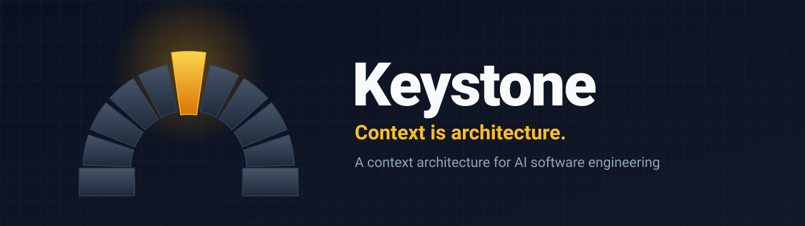
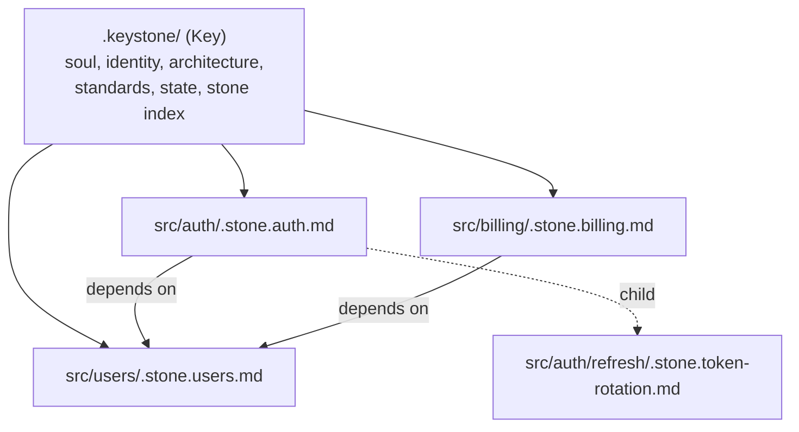

<p align="center">
  
</p>

<p align="center">
  <strong>A context architecture for AI software engineering.</strong><br>
  Give coding agents a map of your system instead of a pile of text to search.
</p>

<p align="center">
  
  
  
  
</p>

<p align="center">
  <a href="#quick-start">Quick start</a> |
  <a href="#how-it-works">How it works</a> |
  <a href="#stones">Stones</a> |
  <a href="#cli-reference">CLI</a> |
  <a href="#agent-integration">Agent integration</a> |
  <a href="#design-principles">Principles</a>
</p>

---

## Why Keystone

Coding agents are good at reading code and bad at knowing *why* it is the way it is. They can tell from the code that tokens expire after 15 minutes, but not that this is your revocation window and must never be raised. Bigger context windows don't fix this. A million tokens of source still don't contain the decision. Meanwhile, long rule lists at the start of a session fade as the conversation fills with diffs and logs.

Keystone takes a different approach: **describe the system as a graph of small context files that live next to the code they govern**, and give agents a predictable way to navigate it.

- **Relevant context over large context.** Agents load the one stone that governs a task, not the whole repository.
- **Descriptions over prohibitions.** Each stone states the system's invariants and the reasons behind them. An agent keeps to them because breaking one would contradict the architecture, not because it remembers a rule.
- **A protocol, not a framework.** Plain Markdown with a small, strict frontmatter. Antigravity, Claude Code, Codex, Cursor, Gemini CLI, a script, or a human can all read it.

## How it works

Keystone has two parts: the **Key**, a centralizer at the project root, and **Stones**, the context nodes it holds together.



```text
your-project/
├── .keystone/                  # The Key
│   ├── soul.md                 # How agents work in this project (entry point)
│   ├── identity.md             # Purpose, audience, lifecycle stage
│   ├── architecture.md         # System overview + generated stone index
│   ├── standards.md            # Code, testing, documentation and Git conventions
│   ├── state.md                # Activation checklist
│   ├── templates/stone.md      # Body template for new stones
│   ├── operations/             # TypeScript CLI (zero dependencies)
│   └── bin/keystone            # Portable launcher (Bun or Node)
└── src/
    ├── auth/
    │   ├── tokens.ts
    │   └── .stone.auth.md      # Stone: co-located, hidden from casual browsing
    └── billing/
        ├── webhook.ts
        └── .stone.billing.md
```

Agents navigate in a fixed order and stop as soon as they have what the task needs:

1. **Key**: `architecture.md` for the system map and the stone index.
2. **Stone**: the stone that governs the area being changed, plus summaries of its neighbors.
3. **Code**: the source itself, read with the stone's invariants in mind.

Stones are dotfiles. File explorers and terminals hide them by default, so your tree stays clean for humans while agents and tools still see every one.

## Quick start

**Requirements:** [Bun](https://bun.sh) 1.2+ or Node.js 22.18+ for the CLI. The protocol itself is plain Markdown and works without either.

**1. Add the Key to your project**

```sh
git clone --depth 1 https://github.com/GustavoLGregorio/keystone.git /tmp/keystone
cp -r /tmp/keystone/.keystone ./
```

**2. Point your agent at the soul**

Add this to the instruction file your agent reads (`AGENTS.md`, `CLAUDE.md`, `GEMINI.md`, `.cursorrules`, and so on):

```markdown
This project uses Keystone for architectural context. Before planning or changing code, read `.keystone/soul.md` and follow it.
```

**3. Activate**

Ask your agent:

```text
Activate the Keystone soul at .keystone/soul.md.
```

The agent works through `.keystone/state.md`:

| Step              | What the agent does                                                                             |
| ----------------- | ----------------------------------------------------------------------------------------------- |
| Versioning        | Checks that `.keystone/` is tracked by Git, or confirms you want it local-only                |
| Core Context      | Drafts `identity.md` and `architecture.md` from evidence in the repository, for your review |
| Commit Convention | Reads `git log`, describes the convention it sees, and records it once you confirm            |
| Stone Map         | Proposes one stone per important module, creates and links them, runs `doctor`                |

It asks all of its questions in one message and finishes with **"Keystone ready."** Once an item is done or declined, it is never asked again.

**4. Check the result**

```sh
.keystone/bin/keystone stone graph
.keystone/bin/keystone stone doctor
```

## Stones

A stone has a small, strict frontmatter (the machine-readable contract) and a free Markdown body (the reasoning).

```markdown
---
id: auth
type: module
tags: [authentication, jwt, session]
relations:
  depends_on: [users]
  depended_by: []
  children: [token-rotation]
summary: Issues and verifies short-lived JWT access tokens for API requests.
---

# Auth

## Purpose and Design Decisions

Access tokens are stateless JWTs so any instance can verify them without a
database round trip. A stateless token cannot be revoked early, so its
lifetime is the revocation window.

## Invariants

- Access tokens expire after 15 minutes. Longer sessions come from refresh
  token rotation (`token-rotation`), never from a longer access token lifetime.

## Integration Contracts

- `issueAccessToken(userId)`, `verifyAccessToken(token)`.

## Anti-Patterns

- Raising the access token TTL to keep users signed in.
```

| Field         | Rules                                                                                                     |
| ------------- | --------------------------------------------------------------------------------------------------------- |
| `id`        | Lowercase kebab-case. Must match the filename: `.stone.<id>.md`                                         |
| `type`      | `module`, `service`, `entity`, `policy` or `integration`                                        |
| `tags`      | Search keywords                                                                                           |
| `relations` | `depends_on` and `depended_by` are kept symmetric by the CLI. `children` builds the navigation tree |
| `summary`   | One sentence. It appears in the index, in search results and in neighbor listings                         |
| `owner`     | Optional team or person                                                                                   |

**Write stones as facts about the system, with reasons.** "Access tokens expire after 15 minutes because this bounds the revocation window" keeps steering an agent long into a session. "NEVER change the TTL" stops working after a few dozen turns.

The frontmatter supports a deliberately small YAML subset: scalars, inline or block lists, a map of lists for `relations`, and folded or literal block scalars. Anything outside that subset is rejected with a line number, so no tool ever misreads it silently.

## CLI reference

```sh
.keystone/bin/keystone stone <command> [options]
```

The launcher uses Bun when available and falls back to Node 22.18+ through native type stripping. You can also call the entry point directly with `bun .keystone/operations/stone.ts` or `node .keystone/operations/stone.ts`. The leading `stone` is optional.

| Command                      | Purpose                                                                                                                                                    |
| ---------------------------- | ---------------------------------------------------------------------------------------------------------------------------------------------------------- |
| `create <id> --path <dir>` | Scaffold a stone next to the code. Options: `--type`, `--tags a,b`, `--summary`, `--owner`, `--depends-on a,b`                                   |
| `search [query]`           | Ranked lexical search over ids, tags, summaries, paths, headings and bodies. All terms must match. Options: `--tag`, `--type`, `--limit`, `--json` |
| `show <id>`                | Prints the stone, a summary of each related stone, and the transitive impact set (everything that depends on it)                                           |
| `relate <source> <target>` | Links two stones and keeps the inverse relation in sync. Options: `--type depends_on\|depended_by\|children`, `--remove`                                 |
| `graph [id]`               | Full navigation tree, or one stone's neighborhood with its impact set. Options: `--format ascii\|mermaid\|json`, `--depth <n>`                           |
| `doctor`                   | Audits the Key and the graph. Options: `--fix`, `--strict`, `--json`, `--ignore code1,code2`                                                       |

**Exit codes:** `0` on success; `1` on invalid input, a search with no results, or a doctor run that finds errors (or warnings, with `--strict`). Scripts and agents can branch on these codes.

<details>
<summary><strong>Example output</strong></summary>

```text
$ keystone stone graph
Key: inkwell-api (4 stones)
├── auth [module] src/auth
│   │   depends on: users
│   └── token-rotation [policy] src/auth/refresh
├── billing [integration] src/billing
│       depends on: users
└── users [entity] src/users

$ keystone stone graph users
users [entity] src/users
    User accounts and subscription plan persisted in PostgreSQL.
└── depended by
    ├── auth [module] src/auth
    └── billing [integration] src/billing

Transitive impact: auth, billing

$ keystone stone search jwt
auth [module] src/auth/.stone.auth.md
    Issues and verifies short-lived JWT access tokens for API requests.
    tags: authentication, jwt, session, login
```

</details>

### What `doctor` checks

| Area        | Diagnostics                                                                                                                                       |
| ----------- | ------------------------------------------------------------------------------------------------------------------------------------------------- |
| Key         | Missing Key files, `identity.md` or `architecture.md` still holding template content, pending activation items                                |
| Schema      | Parse errors with line numbers, invalid filenames, `id` not matching the filename, missing `type` or `summary`, unknown types, missing tags |
| Graph       | Broken relations, self-relations, duplicate ids, duplicate entries, asymmetric `depends_on` / `depended_by`, isolated stones                  |
| Co-location | A stone whose directory no longer contains any code                                                                                               |
| Index       | The generated stone index in `architecture.md` is out of date                                                                                  |

`--fix` repairs only mechanical problems: duplicate entries, missing inverse relations, and a stale index. It never edits a stone's body.

### Standalone binary

```sh
bun build --compile .keystone/operations/stone.ts --outfile keystone
./keystone stone doctor
```

The compiled binary needs no runtime at all, which suits CI and minimal containers.

## Agent integration

Keystone doesn't depend on any particular agent. In practice:

- **Discovery.** Agents tend to look for `AGENTS.md`-style instruction files, so the one-line pointer from the [quick start](#quick-start) is the most reliable way to make them read the soul.
- **Operations.** Agents call the CLI through their terminal tool. `search` and `show` are designed to answer "which part of the architecture governs this?" in a single call.
- **Upkeep.** The soul asks agents to update the affected stones after any change to behavior, contracts or dependencies, and to run `doctor` before calling a task done.
- **Safety.** Irreversible actions follow one policy: state the impact, name what will be lost and how to recover it, wait for explicit confirmation, then act. This includes removing `.keystone/` itself, which is a legitimate choice once you have seen the impact.

## Design principles

1. **Context is architecture.** The structure of the context matters more than its volume.
2. **Navigation over retrieval.** A typed graph with summaries beats a similarity search that returns the right text from the wrong module.
3. **Descriptions over rules.** Invariants written as facts stay coherent over long sessions; prohibitions fade.
4. **Code is the last source of truth, not the first.** Read the stone for intent and constraints, then the code for behavior. When they disagree, raise it.
5. **Protocol over framework.** Plain files, zero runtime dependencies, any agent, any runtime.
6. **Mechanical integrity.** Anything a tool can verify (relations, index, schema) is verified by `doctor`, not left to discipline.

## Upgrading from Agent Slot (v1)

| v1 (Agent Slot)                              | v2 (Keystone)                                                                                 |
| -------------------------------------------- | --------------------------------------------------------------------------------------------- |
| `soul.md` and `memory/` at the slot root | `.keystone/` at the project root                                                            |
| Boot protocol loaded on every session        | Context loaded on demand, in Key, Stone, Code order                                           |
| Deadlock protocol and `guard_rail_logs.md` | One impact-and-confirm policy for irreversible actions                                        |
| Generic `security.md`                      | Module-specific security invariants in stones, plus the operational safety policy in the soul |
| `self_improvement.md`                      | Context upkeep after each change, enforced by `doctor`                                      |
| Folder rename step                           | Fixed `.keystone/` name; the step was removed                                               |

To migrate, move your filled `identity.md`, `architecture.md` and `standards.md` into `.keystone/`, delete the old slot folder, and activate again. The agent will skip any item whose evidence is already in place.

## Roadmap

- `npx keystone` distribution and prebuilt binaries in releases
- Interactive terminal graph explorer
- Optional semantic search as a last-resort layer behind lexical and graph navigation
- Stone templates per type (`policy`, `integration`)

## Contributing

Issues and discussions are welcome. Before opening a pull request:

```sh
bun install
bun run typecheck
```

Commits follow the convention in [.keystone/standards.md](./.keystone/standards.md).

## License

No license has been chosen yet. Until one is added, all rights are reserved.

---

<p align="center"><sub>Keystone - the stone at the top of an arch that locks every other stone in place.</sub></p>
